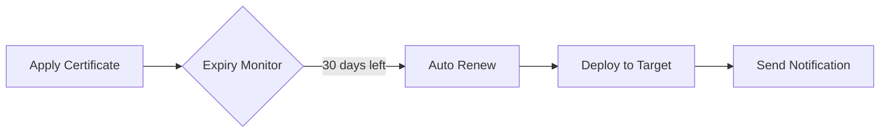
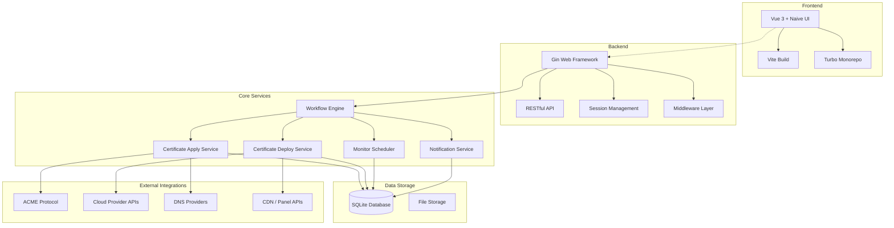

# All in SSL - Complete SSL Certificate Management Tool 🔒

[](https://github.com/allinssl/allinssl?tab=readme-ov-file#AGPL-3.0-1-ov-file)

[](https://github.com/allinssl/allinssl/issues)
[](https://github.com/allinssl/allinssl/releases)
[](https://hub.docker.com/r/allinssl/allinssl)

[中文文档](./README_CN.md)

> 🚀 All-in-one SSL certificate lifecycle management solution | Supports Let's Encrypt, ZeroSSL, Google, SSL.COM, BuyPass and more | Multi-platform deployment | Automated operations

<p align="center">
  
</p>

## 🔀 About This Fork

This repository is forked from [allinssl/allinssl](https://github.com/allinssl/allinssl). The following features have been added on top of upstream:

| Feature | Description |
|---------|-------------|
| **API Key Access** | Call certificate APIs directly via MD5-based signature (`MD5(timestamp + MD5(api_key))`) without a session — ideal for script automation |
| **AWS CloudFront Deployment** | New AWS CloudFront host provider: deploy certificates to CloudFront distributions via IAM |
| **Alibaba Cloud Function Compute Deployment** | New deploy type for Function Compute 3.0 custom domains: replaces only the domain certificate, keeping routes, TLS and other settings unchanged |
| **UpYun SSL Deployment** | New UpYun (又拍云) SSL certificate deployment plugin |
| **Multi-domain Batch Deployment** | Alibaba Cloud CDN/DCDN and Qiniu Cloud CDN/OSS now accept multiple comma-separated domains for one-shot deployment |
| **ARI Protocol Support** | Compatible with ACME Renewal Information (ARI) protocol — respects the CA-recommended renewal window |
| **Manual Certificate Editing** | Manually-uploaded certificates can be edited and updated; updates can trigger associated workflows |
| **Workflow Association Status** | Certificate list shows which workflows reference each cert; deletion warns about affected workflows |
| **Certificate Chain Validation** | Certificate chain completeness and domain coverage are validated on upload and edit |

## 📌 Highlights
- ✅ Fully automated certificate application / renewal
- 🌐 Multi-platform deployment (CDN / WAF / control panels / cloud storage)
- 🔔 Certificate expiration monitoring
- 🛡️ Secure entry protection
- 📊 Visual certificate management

## 🚧 Roadmap

We are actively improving the following features. Feel free to suggest via [GitHub Issues](https://github.com/allinssl/allinssl/issues)!

[](https://github.com/allinssl/allinssl/milestone/1)


## 🚀 Quick Start

### System Requirements
- Linux
- macOS / Windows (script installation not yet supported; see manual steps below)
- Docker

### One-line Install
```bash
curl -sSO http://allinssl.bt.cn/install_allinssl.sh && bash install_allinssl.sh allinssl
```

### One-line Install (Mirror)
```bash
curl -sSO http://download.allinssl.com/install_allinssl.sh && bash install_allinssl.sh allinssl
```

### Docker
```bash
docker run -itd \
  --name allinssl \
  -p 8888:8888 \
  -v /www/allinssl/data:/www/allinssl/data \
  -e ALLINSSL_USER=allinssl \
  -e ALLINSSL_PWD=allinssldocker \
  -e ALLINSSL_URL=allinssl \
  -e TZ=Asia/Shanghai \
  allinssl/allinssl:latest
```

### Binary Installation
1. Open the [releases page](https://github.com/allinssl/allinssl/releases)
2. Download the latest binary for your platform
3. Extract the archive and navigate to the directory in your terminal / CMD
4. Retrieve the login URL, username, and password:
   - URL & username:
     - Linux: `./allinssl 15`
     - Windows: `.\allinssl 15`
   - Password:
     - Linux: `./allinssl 6`
     - Windows: `.\allinssl 6`
5. Start the service (keep the terminal open, or configure a process daemon):
   - Linux: `./allinssl start`
   - Windows: `.\allinssl start`
6. Visit `http://your-server-ip:port/<secure-entry>` and log in
7. See [Command Line Operations](#-command-line-operations) for more commands

### Build from Source
Make sure Go 1.23+ and Node.js 18+ are installed.

#### Step 1: Clone the repository
```bash
git clone https://github.com/allinssl/allinssl.git
cd allinssl
```

#### Step 2: Build frontend assets
```bash
cd frontend
npm install -g pnpm   # if pnpm is not installed
pnpm install
pnpm run build
cd ..
```

> After building, copy the output to `static/build/` so Go can embed it into the binary:
```bash
rm -rf static/build/static/css static/build/static/js
cp -r frontend/apps/allin-ssl/dist/. static/build
```

> ⚠️ **Important**: The icon and image files under `static/build/static/icons/`, `static/build/static/images/`, and `static/build/static/png/` are maintained in Git and are **not** generated by `pnpm build`. Never run `rm -rf static/build` or `rm -rf static/build/*` — doing so will delete these files. If they are accidentally removed, restore them with: `git checkout HEAD -- static/build/static/icons static/build/static/images static/build/static/png static/build/favicon.ico`

#### Step 3: Compile and start
```bash
go mod tidy
go build -o allinssl cmd/main.go
./allinssl start
```

### First-time Setup
1. Visit `http://your-server-ip:port/<secure-entry>`
2. Add DNS provider and host provider credentials ☁️
3. Create a workflow

[Full Installation Docs](https://allinssl.com/guide/getting-started.html)

## 🎯 Core Features

### 📜 Certificate Management


| Feature          | Supported Providers                                     |
|------------------|---------------------------------------------------------|
| DNS Validation   | Alibaba Cloud, Tencent Cloud, Cloudflare...             |
| Certificate Deploy | BaoTa Panel, 1Panel, Alibaba Cloud CDN, Tencent COS  |
| Monitoring / Alerts | Email, Webhook, DingTalk                            |

### ⚙️ Automation Flow


## 🔑 API Key Access

The system supports calling the API directly via an API Key signature, without a session login — convenient for scripted certificate automation.

### Setup

Go to **Settings → API Access**, click "Generate" to create a random key, and save it to enable access. Clearing the key disables API access.

### Signing Algorithm

```
keyMd5    = MD5(api_key)
api_token = MD5(timestamp + keyMd5)
```

Attach the following parameters to every request (either as a query string or form field):

| Parameter | Description |
|------|------|
| `api_token` | The signature (lowercase hex) |
| `timestamp` | Current Unix timestamp in seconds, must be within 5 minutes of server time |

### Python Example

```python
import hashlib, time, urllib.request, urllib.parse

api_key = 'your_api_key'
timestamp = str(int(time.time()))
key_md5   = hashlib.md5(api_key.encode()).hexdigest()
api_token = hashlib.md5((timestamp + key_md5).encode()).hexdigest()

# Download a certificate (id is the certificate ID)
url  = 'http://your-server/v1/cert/download?id=1'
url += f'&api_token={api_token}&timestamp={timestamp}'
urllib.request.urlretrieve(url, 'cert.zip')

# Upload a certificate
data = urllib.parse.urlencode({
    'api_token': api_token,
    'timestamp': timestamp,
    'cert': open('cert.pem').read(),
    'key':  open('key.pem').read(),
}).encode()
req = urllib.request.Request('http://your-server/v1/cert/upload_cert', data)
print(urllib.request.urlopen(req).read().decode())
```

### Available Endpoints

> ⚠️ API Key verification runs as a global middleware — any request carrying a valid `api_token` + `timestamp` can reach any endpoint below (equivalent to session-login privileges). Keep the key safe and never share it with untrusted parties.

<details>
<summary><strong>Certificates</strong> <code>/v1/cert</code></summary>

| Method | Path | Description |
|------|------|------|
| POST | `/v1/cert/get_list` | List certificates |
| POST | `/v1/cert/upload_cert` | Upload a certificate (`cert` + `key` fields) |
| POST | `/v1/cert/update_cert` | Update certificate info |
| POST | `/v1/cert/del_cert` | Delete a certificate |
| GET  | `/v1/cert/download?id={id}` | Download certificate as zip |

</details>

<details>
<summary><strong>ACME Accounts</strong> <code>/v1/acme_account</code></summary>

| Method | Path | Description |
|------|------|------|
| POST | `/v1/acme_account/get_list` | List accounts |
| POST | `/v1/acme_account/get_ca_list` | List available CAs |
| POST | `/v1/acme_account/add_account` | Add an account |
| POST | `/v1/acme_account/del_account` | Delete an account |
| POST | `/v1/acme_account/upd_account` | Update an account |
| POST | `/v1/acme_account/get_account_uri` | Get the account URI (used to configure dns-persist-01 TXT records) |

</details>

<details>
<summary><strong>Access Credentials</strong> <code>/v1/access</code></summary>

| Method | Path | Description |
|------|------|------|
| POST | `/v1/access/get_list` | List credentials (paginated) |
| POST | `/v1/access/get_all` | List all credentials (no pagination) |
| POST | `/v1/access/add_access` | Add a credential |
| POST | `/v1/access/upd_access` | Update a credential |
| POST | `/v1/access/del_access` | Delete a credential |
| POST | `/v1/access/test_access` | Test credential connectivity |
| POST | `/v1/access/get_sites` | List sites (panel-based credentials) |
| POST | `/v1/access/get_eab_list` | List EAB entries (paginated) |
| POST | `/v1/access/get_all_eab` | List all EAB entries |
| POST | `/v1/access/add_eab` | Add an EAB entry |
| POST | `/v1/access/upd_eab` | Update an EAB entry |
| POST | `/v1/access/del_eab` | Delete an EAB entry |
| POST | `/v1/access/get_plugins` | List deployment plugins |
| POST | `/v1/access/get_plugin_actions` | List actions supported by a plugin |
| POST | `/v1/access/get_plugin_raw_metadata` | Get a plugin's raw metadata |

</details>

<details>
<summary><strong>Workflows</strong> <code>/v1/workflow</code></summary>

| Method | Path | Description |
|------|------|------|
| POST | `/v1/workflow/get_list` | List workflows |
| POST | `/v1/workflow/add_workflow` | Add a workflow |
| POST | `/v1/workflow/upd_workflow` | Update a workflow |
| POST | `/v1/workflow/del_workflow` | Delete a workflow |
| POST | `/v1/workflow/exec_type` | Change execution mode (scheduled/manual) |
| POST | `/v1/workflow/active` | Enable / disable a workflow |
| POST | `/v1/workflow/execute_workflow` | Trigger a workflow manually |
| POST | `/v1/workflow/stop` | Stop a running workflow |
| POST | `/v1/workflow/get_workflow_history` | Get execution history |
| POST | `/v1/workflow/get_exec_log` | Get execution logs |
| POST | `/v1/workflow/del_workflow_history` | Delete execution history |

</details>

<details>
<summary><strong>Monitoring</strong> <code>/v1/monitor</code></summary>

| Method | Path | Description |
|------|------|------|
| POST | `/v1/monitor/get_list` | List monitors |
| POST | `/v1/monitor/add_monitor` | Add a monitor |
| POST | `/v1/monitor/upd_monitor` | Update a monitor |
| POST | `/v1/monitor/del_monitor` | Delete a monitor |
| POST | `/v1/monitor/set_monitor` | Enable / disable a monitor |
| POST | `/v1/monitor/get_monitor_info` | Get monitor details |
| POST | `/v1/monitor/get_err_record` | Get error records |
| POST | `/v1/monitor/file_add_monitor` | Bulk-import monitors |
| GET  | `/v1/monitor/template` | Download the bulk-import template |

</details>

<details>
<summary><strong>Notifications</strong> <code>/v1/report</code></summary>

| Method | Path | Description |
|------|------|------|
| POST | `/v1/report/get_list` | List notification channels |
| POST | `/v1/report/add_report` | Add a notification channel |
| POST | `/v1/report/upd_report` | Update a notification channel |
| POST | `/v1/report/del_report` | Delete a notification channel |
| POST | `/v1/report/notify_test` | Send a test notification |

</details>

<details>
<summary><strong>Private CA</strong> <code>/v1/private_ca</code></summary>

| Method | Path | Description |
|------|------|------|
| POST | `/v1/private_ca/create_root_ca` | Create a root CA |
| POST | `/v1/private_ca/create_intermediate_ca` | Create an intermediate CA |
| POST | `/v1/private_ca/get_ca_list` | List CAs |
| POST | `/v1/private_ca/del_ca` | Delete a CA |
| POST | `/v1/private_ca/create_leaf_cert` | Issue a leaf certificate |
| POST | `/v1/private_ca/get_leaf_cert_list` | List leaf certificates |
| POST | `/v1/private_ca/del_leaf_cert` | Delete a leaf certificate |
| GET  | `/v1/private_ca/download_cert` | Download a leaf certificate |

</details>

<details>
<summary><strong>Settings / Overview</strong> <code>/v1/setting</code>, <code>/v1/overview</code></summary>

| Method | Path | Description |
|------|------|------|
| POST | `/v1/setting/get_setting` | Get system settings |
| POST | `/v1/setting/save_setting` | Save system settings |
| POST | `/v1/setting/save_api_key` | Generate / clear the API Key |
| POST | `/v1/setting/get_version` | Get version info |
| POST | `/v1/setting/shutdown` | Shut down the service |
| POST | `/v1/setting/restart` | Restart the service |
| GET  | `/v1/setting/download_data` | Export a data backup |
| POST | `/v1/setting/upload_data` | Import a data backup |
| POST | `/v1/overview/get_overviews` | Get home page overview data |

</details>

## 🛠️ Architecture

### 🏗️ System Architecture


## 📚 Documentation
- [Getting Started](https://allinssl.com/guide/getting-started.html)
- [User Manual](https://allinssl.com/features/dashboard.html)

## 💻 Command Line Operations
```bash
# Basic Operations
allinssl 1:  Start service 🚀
allinssl 2:  Stop service ⛔
allinssl 3:  Restart service 🔄
allinssl 4:  Modify secure entry 🔐
allinssl 5:  Modify username 👤
allinssl 6:  Modify password 🔑
allinssl 7:  Modify port 🔧

# Web Service Management
allinssl 8:  Disable web service 🌐➖
allinssl 9:  Enable web service 🌐➕
allinssl 10: Restart web service 🌐🔄

# Background Task Management
allinssl 11: Disable background scheduler 📻⛔
allinssl 12: Enable background scheduler 📻✅
allinssl 13: Restart background scheduler 📻🔄

# System Management
allinssl 14: Disable HTTPS 🔓
allinssl 15: Get panel URL 📋
allinssl 16: Update ALLinSSL to latest version (overwrite install) 🔄⬆️
allinssl 17: Uninstall ALLinSSL 🗑️
```

## 🤝 Contributing
Contributions are welcome in the following ways:
1. Report bugs via Issues
2. Submit Pull Requests 💻
3. Improve documentation 📖
4. Share your use cases ✨

[Contributing Guide](https://allinssl.com/community/contributing.html)

## 📞 Contact
- QQ Group: [768610151](https://qm.qq.com/q/KTmWuskjm0) 👥
- Email: support@allinssl.com 📧
- Bug Reports: [GitHub Issues](https://github.com/allinssl/allinssl/issues)

## 🙏 Acknowledgements

**Open-source projects and communities in the SSL certificate space:**
- [Let's Encrypt](https://letsencrypt.org/) - Free SSL certificate authority
- [lego](https://github.com/go-acme/lego) - Go ACME client powering core certificate issuance
- [acme.sh](https://github.com/acmesh-official/acme.sh) - Pure-shell ACME client
- [certimate](https://github.com/usual2970/certimate) - Workflow design reference; JD Cloud DNS implementation
- [certd](https://github.com/certd/certd) - Workflow design reference
- [Certbot](https://certbot.eff.org/) - EFF's official ACME client
- [Caddy](https://caddyserver.com/) - Automatic HTTPS web server

**Technology stack & dependencies:**

**🔧 Backend**
- **Web Framework**: [gin-gonic/gin](https://github.com/gin-gonic/gin)
- **Database**: [modernc.org/sqlite](https://github.com/modernc/sqlite)
- **ACME Client**: [go-acme/lego](https://github.com/go-acme/lego)
- **Session**: [gin-contrib/sessions](https://github.com/gin-contrib/sessions)
- **HTTP Client**: [go-resty/resty](https://github.com/go-resty/resty)
- **Email**: [jordan-wright/email](https://github.com/jordan-wright/email)
- **Captcha**: [mojocn/base64Captcha](https://github.com/mojocn/base64Captcha)
- **UUID**: [google/uuid](https://github.com/google/uuid)
- **Env Config**: [joho/godotenv](https://github.com/joho/godotenv)

**🎨 Frontend**
- **Framework**: [Vue 3](https://vuejs.org/)
- **UI Components**: [Naive UI](https://naiveui.com/)
- **Build Tool**: [Vite](https://vitejs.dev/)
- **Monorepo**: [Turbo](https://turbo.build/)
- **Router**: [Vue Router](https://router.vuejs.org/)
- **State Management**: [Pinia](https://pinia.vuejs.org/)
- **Utilities**: [VueUse](https://vueuse.org/)
- **Charts**: [ECharts](https://echarts.apache.org/)
- **Workflow Editor**: [Vue Flow](https://vueflow.dev/)
- **HTTP**: [Axios](https://axios-http.com/)
- **CSS**: [TailwindCSS](https://tailwindcss.com/)

**☁️ Cloud Integrations**
- **Alibaba Cloud**: [alibabacloud-go](https://github.com/alibabacloud-go) SDK
- **Tencent Cloud**: [tencentcloud-sdk-go](https://github.com/tencentcloud/tencentcloud-sdk-go)
- **Huawei Cloud**: [huaweicloud-sdk-go-v3](https://github.com/huaweicloud/huaweicloud-sdk-go-v3)
- **Baidu Cloud**: [bce-sdk-go](https://github.com/baidubce/bce-sdk-go)
- **Volcengine**: [volcengine-go-sdk](https://github.com/volcengine/volcengine-go-sdk)
- **JD Cloud**: [jdcloud-sdk-go](https://github.com/jdcloud-api/jdcloud-sdk-go)
- **Qiniu**: [qiniu/go-sdk](https://github.com/qiniu/go-sdk)
- **Azure**: [azure-sdk-for-go](https://github.com/Azure/azure-sdk-for-go)
- **AWS**: [aws-sdk-go-v2](https://github.com/aws/aws-sdk-go-v2)
- **Cloudflare**: [cloudflare-go](https://github.com/cloudflare/cloudflare-go)

**Certificate Authorities:**
- [Let's Encrypt](https://letsencrypt.org/) - Free SSL certificates
- [ZeroSSL](https://zerossl.com/) - Free SSL certificates
- [Google Trust Services](https://pki.goog/)
- [SSL.com](https://www.ssl.com/)
- [BuyPass](https://www.buypass.com/)
- [TrustAsia](https://www.trustasia.com/)
- [Racent](https://www.racent.com/)

**Special thanks to all DNS providers and CDN vendors for their open APIs.**

**Thanks to the following contributors:**
- [@寒雨馨](https://www.hanyuxin.cn/)


## 📜 License
This project is licensed under the [AGPL-3.0 license](./LICENSE).

## 🌟 Star History

[](https://www.star-history.com/#allinssl/allinssl&Date)

---

> 🌟 **Star this project to support development** | Recommended for: small-to-medium site operations, multi-certificate management, and automated HTTPS deployment
